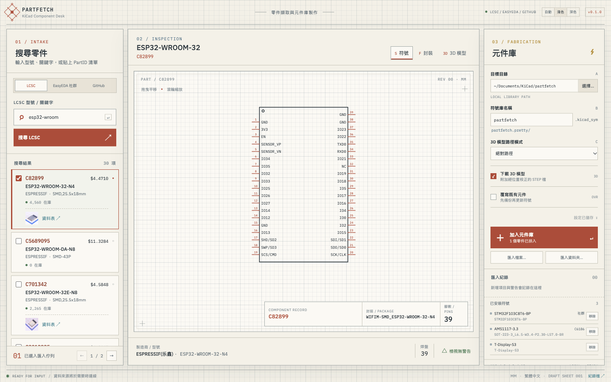
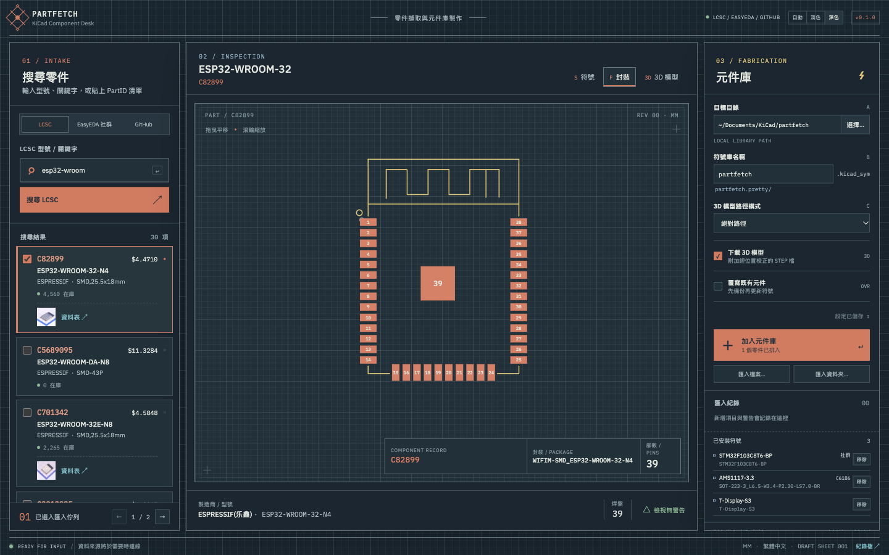
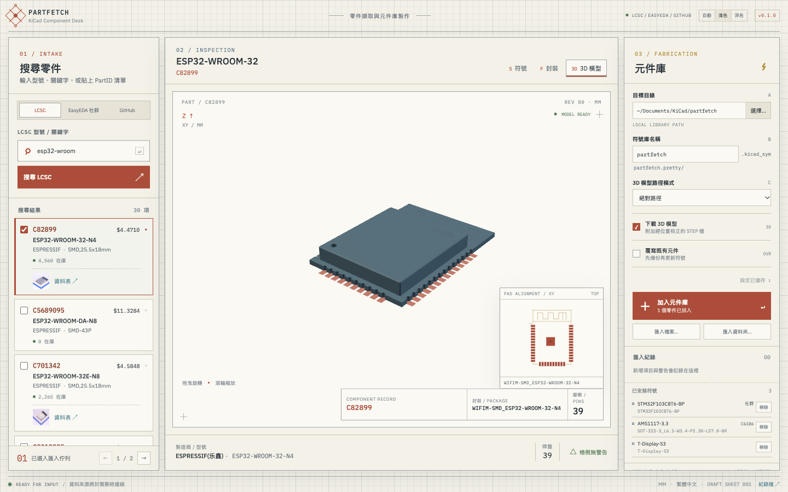

# kicad-partfetch

把零件的**符號、封裝、3D 模型**抓下來，直接寫進你的 KiCad 元件庫。

輸入 LCSC 編號（例如 `C2040`）或關鍵字，預覽確認後按一下就加入；不必再手動下載、轉檔、對 3D 模型的位置。

> **English** — A desktop tool (macOS / Windows) and CLI that fetches a part's symbol, footprint and 3D model from LCSC / EasyEDA, the EasyEDA community library or a GitHub repository, previews them, and merges them into a KiCad library (KiCad 8 file format, readable by KiCad 8 / 9 / 10). The interface is in Traditional Chinese. [Download](https://github.com/sywung/kicad-partfetch/releases/latest) · [Sponsor](https://donate.twater.cc)



| 深色主題 | 3D 預覽 |
|---|---|
|  |  |

## 功能

- **三種線上來源**
  - **LCSC**：用 C 編號或關鍵字搜尋，顯示庫存、價格、資料表連結。
  - **EasyEDA 社群**：使用者貢獻的元件（開發板、模組等），未經審核，加入前請自行確認腳位。
  - **GitHub**：搜尋放有 KiCad 檔案的 repo，整包預覽後加入。
- **加入前先預覽**：符號、封裝、3D 模型都能看；符號與封裝可用滾輪縮放、拖曳平移，接腳再多也看得清楚。
- **3D 模型自動對位**：LCSC／EasyEDA 的模型會依封裝外框算出位置與旋轉，加入後在 KiCad 的 3D 檢視器就是對的。
- **匯入本機檔案**：SnapEDA、Ultra Librarian 等網站下載的 zip、資料夾或單一檔案，可直接併入同一個元件庫。舊版 `.lib` 符號庫會自動轉成新格式。
- **元件庫管理**：列出已安裝的零件、再次預覽、移除。
- **批次加入**：一次貼上多個編號。
- **淺色／深色主題**，可跟隨系統。
- **CLI**：同一套核心，適合寫進腳本。

## 下載與安裝

到 [Releases](https://github.com/sywung/kicad-partfetch/releases/latest) 下載：

| 平台 | 檔案 | 說明 |
|---|---|---|
| macOS（Apple Silicon／Intel） | `kicad-partfetch-<版本>-macos-universal.zip` | 解壓縮後把 `kicad-partfetch.app` 拖進「應用程式」。已簽章並經 Apple 公證。 |
| Windows 10／11（x64） | `kicad-partfetch-<版本>-windows-amd64.zip` | 解壓縮後執行 `kicad-partfetch.exe`。 |
| Windows 11（ARM64） | `kicad-partfetch-<版本>-windows-arm64.zip` | 同上。 |

Windows 版沒有程式碼簽章，第一次執行時 SmartScreen 會出現警告，按「其他資訊」→「仍要執行」。Windows 10 需要 [WebView2 Runtime](https://developer.microsoft.com/microsoft-edge/webview2/)（Windows 11 已內建）。

**需求**：KiCad 8 以上。預覽 GitHub 來源、預覽已安裝的零件、轉換舊版符號庫時會用到 KiCad 附的 `kicad-cli`；程式會自動尋找，找不到時仍可加入零件，只是沒有那幾種預覽。

## 使用教學

### 1. 設定元件庫位置

右側「元件庫」面板：

- **目標目錄**：元件庫要放在哪裡，預設是 `文件/KiCad/partfetch`。
- **符號庫名稱**：預設 `partfetch`，會產生下面這些檔案。
- **3D 模型路徑模式**：一般用「絕對路徑」。要把元件庫跟著專案一起搬移時選「專案相對（KIPRJMOD）」。

```
<目標目錄>/partfetch.kicad_sym            符號庫
<目標目錄>/partfetch.pretty/*.kicad_mod   封裝
<目標目錄>/partfetch.3dshapes/*.step      3D 模型
```

### 2. 搜尋並預覽

1. 左側選來源（LCSC／EasyEDA 社群／GitHub）。
2. 輸入編號或關鍵字後按 Enter。也可以一次貼上多個編號（空白或換行分隔）。
3. 點搜尋結果，中間會顯示**符號**、**封裝**、**3D 模型**三個分頁。
4. 符號與封裝：滾輪縮放、拖曳平移、雙擊回到原狀。3D：拖曳旋轉、滾輪縮放。

### 3. 加入元件庫

1. 勾選要加入的搜尋結果（可多選）。
2. 按右側的「加入元件庫」。
3. 下方「匯入紀錄」會列出每個零件的結果；已存在且內容相同的會標示未變更，不會重複寫入。

要覆蓋既有的同名零件，先勾「覆寫既有元件」（符號庫會先備份成 `.bak`）。

### 4. 在 KiCad 裡使用（只需做一次）

1. KiCad →「偏好設定」→「管理符號庫」→ 加入 `<目標目錄>/partfetch.kicad_sym`。
2. KiCad →「偏好設定」→「管理封裝庫」→ 加入 `<目標目錄>/partfetch.pretty` 這個資料夾。

之後新加入的零件會自動出現在這兩個元件庫裡，不必重新登記。

### 匯入已下載的檔案

右側「匯入檔案…」「匯入資料夾…」可以選 zip、資料夾，或單一的 `.kicad_sym`／`.kicad_mod`／`.step`／`.wrl`。符號沒有指定封裝時，會依名稱自動配對同一包裡的封裝，並在紀錄裡提醒你確認。

### 出問題時

錯誤訊息會說明是找不到零件、連不上來源、還是目錄寫不進去。詳細原因記錄在紀錄檔，按視窗右下角的「紀錄檔 ↗」可以打開所在資料夾：

| 平台 | 位置 |
|---|---|
| macOS | `~/Library/Application Support/kicad-partfetch/partfetch.log` |
| Windows | `%AppData%\kicad-partfetch\partfetch.log` |

回報問題時請附上這個檔案的相關幾行。

## CLI

Windows 的壓縮檔內附 `partfetch.exe`；macOS 另有 `partfetch-<版本>-macos-universal.zip`。

```bash
# 加入零件（可一次多個）
partfetch add --out ~/Documents/KiCad/partfetch --lib partfetch C2040 C8734

# 只看零件資訊，不寫入
partfetch info C5446

# 搜尋：--source 可為 lcsc（預設）、easyeda、github
partfetch search --source github t-display-s3

# 從 EasyEDA 社群或 GitHub 加入
partfetch add --out ~/Documents/KiCad/partfetch --lib partfetch easyeda:<uuid>
partfetch add --out ~/Documents/KiCad/partfetch --lib partfetch github:<owner>/<repo>

# 匯入本機檔案（zip／資料夾／單檔）
partfetch import --out ~/Documents/KiCad/partfetch --lib partfetch ~/Downloads/part.zip

# 列出與移除
partfetch list   --out ~/Documents/KiCad/partfetch --lib partfetch
partfetch remove --out ~/Documents/KiCad/partfetch --lib partfetch C2040
```

GitHub 搜尋未登入時有較嚴格的次數限制；設定環境變數 `GITHUB_TOKEN` 可以提高上限。

## 從原始碼建置

需要 Go 1.27 以上、Node.js 20 以上，以及 [Wails v2](https://wails.io/docs/gettingstarted/installation)。

```bash
git clone https://github.com/sywung/kicad-partfetch.git
cd kicad-partfetch

wails build                                  # GUI，產出在 build/bin/
wails dev                                    # 開發模式
go build -o bin/partfetch ./cmd/partfetch    # CLI
go test ./...                                # 測試
```

設計文件在 `docs/`：`SPEC.md`（核心、格式對照、3D 對位）、`SPEC-GUI.md`、`SPEC-LIBRARY.md`、`SPEC-IMPORT.md`、`SPEC-SOURCES.md`。

## 贊助

這個工具免費、開源，由我利用空閒時間維護。如果它替你省下了時間，歡迎請我喝杯咖啡，讓我有動力繼續加新來源、修問題：

**☕ [donate.twater.cc](https://donate.twater.cc)**

## 注意事項

- **請自行確認腳位與尺寸。** 線上來源的資料可能有誤，EasyEDA 社群與 GitHub 的內容尤其未經審核。下單打板前請對照資料表。
- 元件資料與 3D 模型的著作權屬於原提供者，使用時請遵守 LCSC／EasyEDA 與各 GitHub repo 的授權條款。
- easyeda.com 對短時間內的大量請求會暫時封鎖 IP；程式內建節流、鏡像站與磁碟快取，一般使用不會遇到。
- 本專案與 KiCad、LCSC、EasyEDA 沒有關聯，也未獲其背書。

## 授權

[MIT](LICENSE) © 2026 sywung
